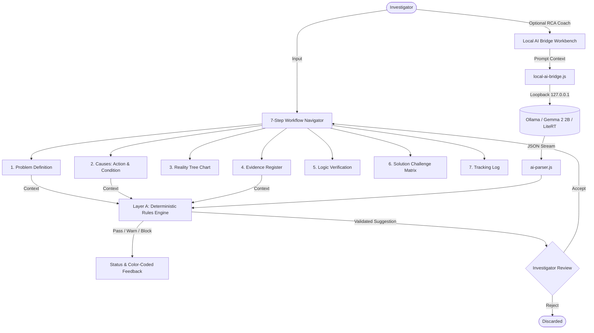

# Architecture & Technical Design: H2C Root Cause Analyst

## 1. System Topology & Philosophy

The **H2C Root Cause Analyst** is an open-source, client-side, privacy-first web application for Root Cause Analysis based on Dean L. Gano's Apollo RCA and RealityCharting principles.

### Key Architectural Tenets:
1. **Standard Mode First**: The full Apollo RCA methodology functions completely without AI models or network connectivity.
2. **Zero Third-Party Data Leakage**: In Standard Mode and Local AI Mode, no incident records, PII, or investigation notes leave the investigator's local computer.
3. **Dual-Layer Anti-Rubber-Stamping Engine**:
   - **Layer A (Deterministic)**: 15 core Apollo RCA principles enforced deterministically (`rca-rules.js` and `rca-integrity.js`).
   - **Layer C (Advisory AI)**: Generative advice via in-browser Web Worker or external local daemon. AI suggestions can NEVER override or downgrade a deterministic `BLOCK`.
4. **Low-Resource Hardware Optimization**:
   - Built to run seamlessly on older laptops (e.g. Dual-Core CPUs, 2–4 GB RAM).
   - Local AI Daemon Bridge offloads inference to local background daemons (Ollama / LiteRT) with **0 MB in-browser memory overhead**.

---

## 2. Core Modules Breakdown

```
apollo-rca/
├── index.html                 # Entry point with SSR pre-render and hydration bootstrap
├── h2c-shell.js               # Reactive UI Shell, 7-Step Workflow Hub, Coach Workbench, Legal Showcase
├── local-ai-bridge.js         # Offline Local Daemon Bridge (Ollama / Gemma 2 / Qwen 2.5 / LiteRT)
├── rca-rules.js               # Apollo RCA deterministic rules (Noun-Verb, Blame, Temporal, Causation)
├── rca-integrity.js           # 15-Principle Registry, Evidence Binding, and Review Pipeline
├── rca-principles.js          # Canonical principles catalog (P01–P15) with hard/warn severities
├── ai-service.js              # Layer C task orchestrator and prompt context builder
├── ai-parser.js               # Resilient JSON parser, XSS sanitizer, think-tag stripper
├── case-io.js                 # Pure JSON case export and strict import schema validator
├── h2c-videos.js              # 7-Episode Official Apollo RCA Video Training Hub
├── help-kb.js                 # Built-in searchable Knowledge Base
├── help-diagrams.js           # SVG interactive diagrams (Causal Relationship, 4-Element Formula)
└── e2e-workflow.test.mjs      # End-to-end integration and workflow test suite
```

---

## 3. Data Flow Diagram



---

## 4. Local AI Bridge Daemon Integration

The Local AI Daemon Bridge communicates exclusively with local background processes:
- **Default Endpoint**: `http://127.0.0.1:11434`
- **Supported Backends**:
  1. **Ollama**: Native `/api/tags` and `/api/chat` endpoints.
  2. **OpenAI-Compatible Local Servers**: LM Studio, LocalAI, and Google LiteRT server on `/v1/models` and `/v1/chat/completions`.
- **Recommended Models**:
  - `gemma2:2b`: Google Gemma 2 2B (~1.6 GB RAM) - optimal for Apollo RCA causal reasoning.
  - `qwen2.5:1.5b`: Qwen 2.5 1.5B (~1.2 GB RAM) - fast structured JSON compliance.
  - `llama3.2:1b`: Llama 3.2 1B (~0.9 GB RAM) - runs smoothly on legacy hardware.

---

## 5. Security & Verification Invariants

- **Test Suite**: 68 tests executed via native `node --test` with 100% pass rate.
- **Network Invariant (`rca.test.mjs:53`)**: Asserts that core modules contain zero external network calls.
- **Single-Source Invariant (`ai-pipeline.test.mjs:44`)**: Ensures model IDs are never hardcoded across loose files.
- **Safe Harbor & Attribution**: Nominative Fair Use disclaimers and attribution to original author Dean L. Gano and Apollonian Publications, LLC.
